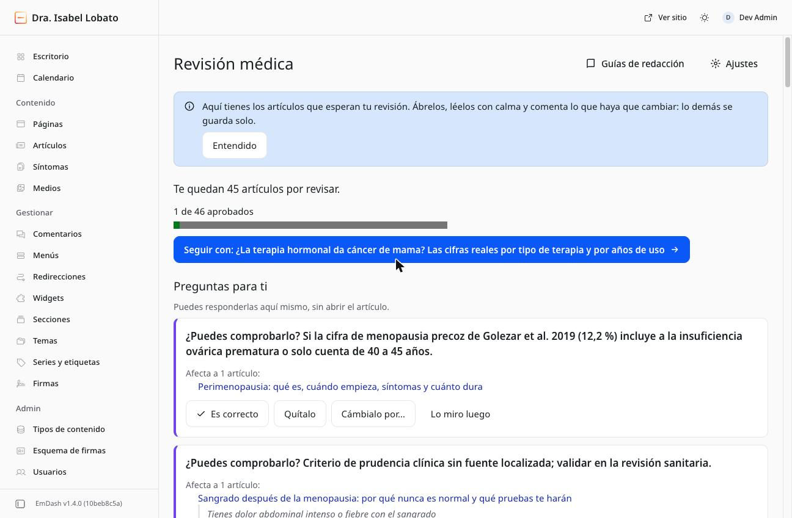
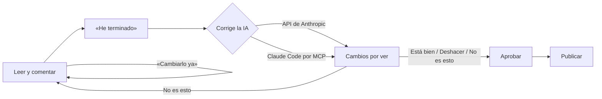
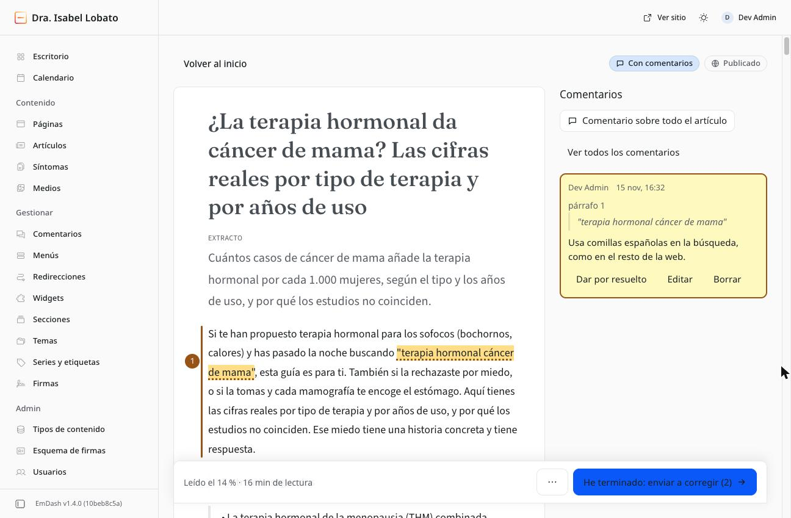
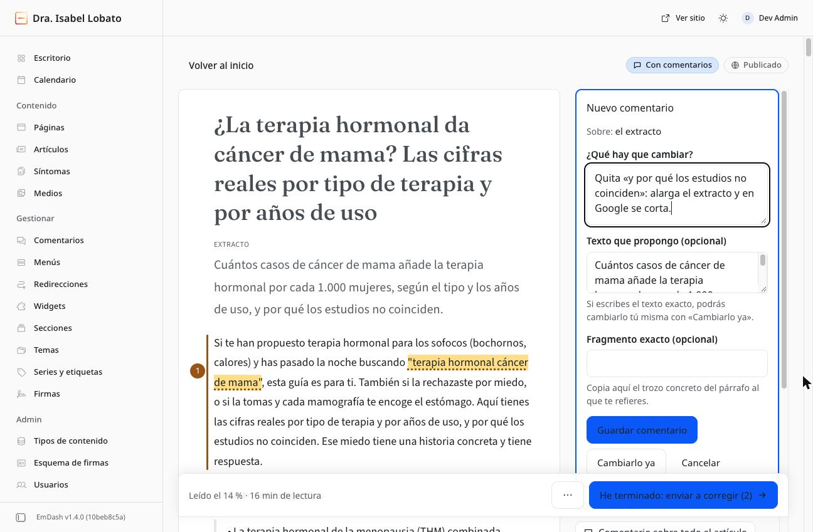
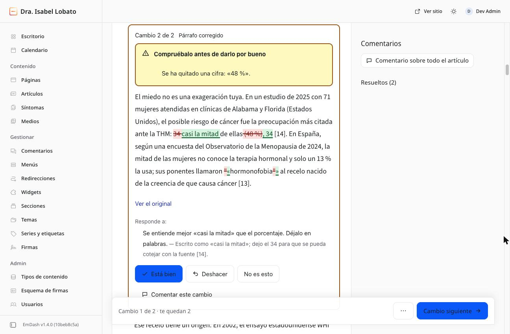
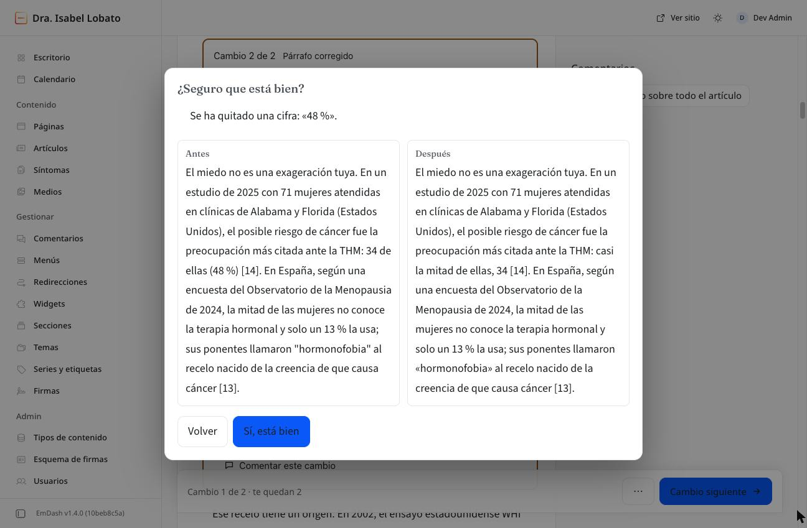
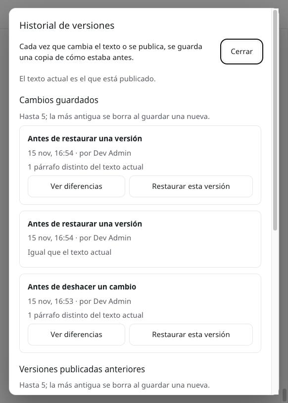
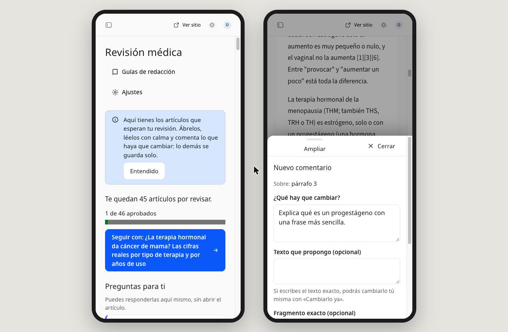
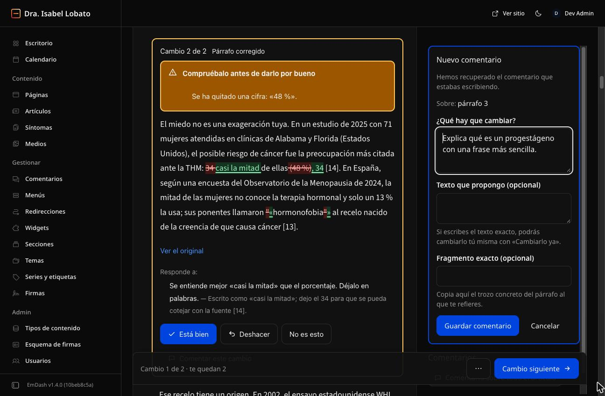
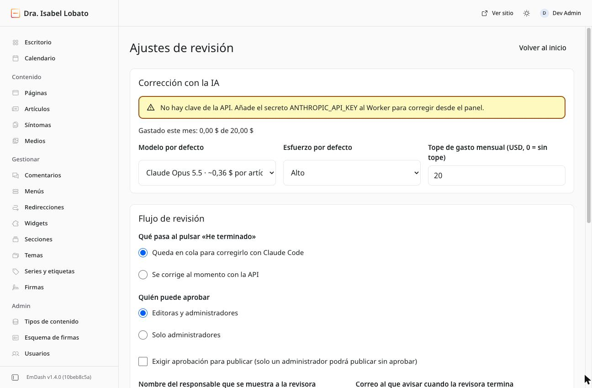

# emdash-revision

**Revisión editorial para [EmDash CMS](https://emdashcms.com).** La revisora lee el artículo tal como saldrá en la web, comenta párrafos o frases, una IA aplica las correcciones como si fuera la redactora, y ella revisa cada cambio antes de aprobar y publicar.



Nació en [isabellobato.es](https://isabellobato.es), una web de divulgación médica sobre la menopausia en la que una doctora revisa y firma cada artículo, y que se escribe y corrige con agentes de IA. Hasta entonces la revisión iba por correo y sus indicaciones se aplicaban a mano. Las capturas de este README son de esa web. El código no tiene nada propio de ella: sirve para cualquier sitio EmDash en el que alguien revise textos antes de publicarlos.

> **Ninguna IA aprueba ni publica.** El plugin corrige, pero la última palabra siempre la tiene una persona: cada cambio se ve, se acepta o se deshace, y la aprobación queda a su nombre y ligada a esa versión exacta del texto.

---

## Cómo se trabaja



### 1. Leer como se verá en la web

La vista de lectura usa la tipografía del sitio y el mismo ancho de columna. Cada unidad del texto se puede comentar: párrafo, título, extracto, celda de tabla, pie y texto alternativo de una imagen, y referencia bibliográfica. Las marcas van al margen y solo el comentario activo se resalta, para no ensuciar la lectura.



### 2. Comentar, o cambiarlo una misma

El formulario pide «¿Qué hay que cambiar?». Opcionalmente admite el texto exacto que se propone y el fragmento concreto. Si la revisora escribe el texto exacto, **«Cambiarlo ya»** lo aplica sin pasar por la IA: es instantáneo, queda registrado y se puede deshacer. Lo que se escribe se guarda solo en el dispositivo, así que un corte de conexión o una sesión caducada no lo pierden.



### 3. La IA corrige solo lo comentado

Al pulsar «He terminado», la IA recibe el artículo por bloques, los comentarios, las guías de redacción del sitio y las reglas que la revisora ya ha respondido. Devuelve **operaciones por bloque**, no un artículo nuevo, y el servidor las valida antes de guardar:

- Solo se puede tocar un bloque que exista y que tenga un comentario. Si toca otro, el cambio se marca como «cambio que no pediste».
- Se señala cualquier cita `[n]` que no exista en las referencias y cualquier enlace nuevo.
- Los bloques no tocados quedan **idénticos byte a byte**, así que los comentarios siguen en su sitio.
- Si alguien editó el artículo mientras se corregía, no se pisa nada: la corrección queda guardada aparte como conflicto.

### 4. Segunda revisión: cada cambio, en su sitio

Lo antiguo aparece tachado y lo nuevo subrayado, por palabra y dentro del propio artículo. Cada cambio tiene tres botones: **Está bien**, **Deshacer** (devuelve el párrafo a como estaba) y **No es esto** (reabre el comentario con una nota). Bajo el cambio, la nota de la IA explica cómo lo resolvió.



**Los cambios delicados no se aceptan de un clic.** Si un cambio toca cifras, dosis, unidades, nombres de fármacos, negaciones o cuantificadores («no», «nunca», «más», «menos»…), el plugin lo señala y pide confirmación viendo el antes y el después.



### 5. Preguntas para la revisora

Las dudas del redactor («¿esta cifra incluye a…?») llegan como **Preguntas para ti** en el inicio, con la frase a la que se refieren. Se responden sin abrir el artículo: *Es correcto*, *Quítalo*, *Cámbialo por…* o *Lo miro luego*. Una pregunta puede afectar a varios artículos, y su respuesta se guarda como regla que la IA respeta a partir de entonces.

### 6. Aprobar y publicar

- **Lectura completa:** «Aprobar» solo pasa a ser el botón principal cuando se ha leído el artículo entero; antes, aprobar pide confirmación y dice qué porcentaje se ha leído. Cada bloque cuenta como leído tras un segundo a la vista; desplazarse deprisa hasta el final no vale.
- **Aprobación ligada a la versión:** queda guardada con el nombre de quien aprueba, la fecha y un hash del texto. Si el texto cambia después, el artículo pasa a «Aprobado · cambiado después».
- **Fecha de revisión:** aprobar puede rellenar un campo de fecha del artículo (por ejemplo, «revisado el…»).
- **Publicar sin aprobación:** muestra un aviso con quién aprobó qué versión. Hay una opción para impedirlo del todo.
- **Auditoría:** queda registrado quién comentó, corrigió, aprobó y publicó cada versión.

### 7. Historial de versiones

Cada cambio en el texto deja guardada una copia de cómo estaba antes: «Cambiarlo ya», la corrección de la IA, deshacer un cambio, restaurar una versión o una edición hecha en el editor de EmDash. Y al publicar, lo que estaba publicado se guarda como **versión publicada anterior**, también cuando se publica desde el editor nativo.

- **Historial de versiones**, en el menú «⋯» del artículo: dos listas, *Cambios guardados* y *Versiones publicadas anteriores*, con el motivo, la fecha, quién lo hizo y cuántos párrafos difieren del texto actual.
- **Ver diferencias:** lo que tenía la copia, tachado; lo que hay ahora, subrayado, párrafo a párrafo.
- **Restaurar:** la copia vuelve al borrador y el texto actual se guarda antes como copia, así que también se puede deshacer. En las versiones publicadas, *Restaurar y publicar* pasa por la misma confirmación que «Publicar ahora».
- **Hasta 5 copias de cada tipo** por artículo (5 de cambios y 5 de publicaciones); al guardar una nueva se borra la más antigua.



---

## En el móvil también

En pantallas estrechas, un toque marca el párrafo y el comentario se escribe en una hoja inferior, sin perder el sitio de lectura. En el ordenador, además, se puede seleccionar una frase concreta.



## Claro y oscuro

Usa los colores del admin de EmDash y sigue su selector de tema. Los estados nunca se indican solo con color: llevan siempre icono y texto, y los cambios se distinguen por el tachado y el subrayado.



---

## Dos formas de corregir con IA

| | **API de Anthropic** | **Claude Code (tu suscripción)** |
|---|---|---|
| Quién lo lanza | El botón del panel; o «He terminado», si así se configura | `/aplicar-revision` en Claude Code, o una tarea programada |
| Dónde corre | En segundo plano, en el cron del plugin: se puede cerrar la página | En tu ordenador, con tus herramientas MCP |
| Modelo | Claude Opus 5.5, Sonnet 5.5, Haiku 5.5 o Fable 5.2, a elegir | El de tu sesión de Claude Code |
| Coste | Por uso, con registro y tope mensual | Incluido en la suscripción |
| Requisito | Secreto `ANTHROPIC_API_KEY` en el Worker | Token personal para el MCP del sitio |

**Por API.**

```sh
wrangler secret put ANTHROPIC_API_KEY
```

Con cambios por párrafo, corregir un artículo de unas 2.500 palabras cuesta unos céntimos con Sonnet u Opus, y menos de un céntimo con Haiku.

**Por Claude Code.** El plugin expone cuatro herramientas MCP: `revision_cola`, `revision_reclamar`, `revision_articulo` y `revision_entregar`. La skill [`skills/aplicar-revision`](skills/aplicar-revision/SKILL.md) enseña a Claude Code a recoger la cola, corregir como redactora y entregar.

```sh
claude mcp add --transport http mi-sitio https://mi-sitio.es/_emdash/api/mcp \
  --header "Authorization: Bearer <token con el scope mcp:tools:emdash-revision>"
```

Cada instalación usa su propio Claude Code con la suscripción de quien lo ejecuta. El plugin nunca ve ni guarda esas credenciales.



---

## Instalación

Es un plugin *native* de EmDash (≥ 1.4), con el panel en React.

```sh
pnpm add github:noelserdna/emdash-revision
```

```js
// astro.config.mjs
import { revisionPlugin } from "emdash-revision";

emdash({
	plugins: [
		revisionPlugin({
			etiqueta: "Revisión",
			collections: {
				posts: {
					// Campos por defecto: title, excerpt, content, references y featured_image.
					campoRevisado: "reviewed_at", // fecha que se rellena al aprobar (opcional)
					urlPublica: "/blog/",
				},
			},
			lectura: {
				cuerpo: '"Source Sans 3", system-ui, sans-serif',
				titulos: "Fraunces, Georgia, serif",
				css: "https://fonts.googleapis.com/css2?family=Fraunces:wght@500&family=Source+Sans+3:wght@400;600&display=swap",
			},
		}),
	],
});
```

- Si el plugin se enlaza desde una carpeta local (`link:`), añádelo a `vite.ssr.noExternal`.
- **Requisito:** la colección revisada debe tener las revisiones activadas (`supports: ["revisions"]`). Así las correcciones se guardan como borrador y lo publicado no cambia hasta que alguien publica.

### Permisos

| Rol | Puede |
|---|---|
| **Editora** (`plugins:read`) | Leer, comentar, «Cambiarlo ya», responder preguntas, revisar cambios, aprobar (si el rol configurado lo permite), publicar, ver y restaurar versiones, y pulsar «He terminado» |
| **Administrador** (`plugins:manage`) | Todo lo anterior, más guías de redacción, ajustes, corregir con la API eligiendo modelo y las herramientas MCP |

---

## Desarrollo

```sh
pnpm install
pnpm test        # 180 tests: librerías, motor de IA, servidor y panel
pnpm typecheck
pnpm build       # tsdown → dist/
```

| Carpeta | Qué hay |
|---|---|
| `src/lib/` | Librerías puras: Portable Text ↔ Markdown por bloque, anclas de comentarios que sobreviven a ediciones, operaciones de corrección, diff por palabras y detección de cambios sensibles. Se publican también como `emdash-revision/lib` para usarlas desde scripts. |
| `src/plugin.ts` | Rutas, hooks (`content:afterSave` re-ancla comentarios y detecta ediciones externas; `content:afterDelete`; `cron` para el motor por API) y herramientas MCP. |
| `src/admin/` | Panel React con CSS propio (prefijo `rv-`) sobre las variables de color del admin de EmDash. Diseñado según WCAG 2.2 AA. |
| `skills/aplicar-revision/` | Skill de Claude Code para el motor por suscripción. |
| `docs/CONTRATO.md` | Contrato interno entre módulos: tipos, rutas y reglas de negocio. |

Los tests de conversión usan como prueba dorada ocho artículos reales de isabellobato.es (`test/fixtures/`): convertir cada bloque a Markdown y de vuelta debe dejarlo idéntico.

## Licencia

Apache-2.0.
